<div align="center">



<br>

<a href="https://www.linkedin.com/in/shriyam-gupta-a6a2222b2"></a>
<a href="https://github.com/Shriyam-22?tab=repositories"></a>

</div>

<br>

### `$ whoami`

I build AI products that hold up outside the demo: LLM agents with real tools, guardrails that check the model's work in code, and eval suites that say whether a change made things better or worse. I also ship the software around them, from REST APIs and databases to the interface people actually use.

I come from test automation, and it shows: I ship with tests that run offline, and back AI claims with evals, not screenshots.

Each project starts from a real user's problem, not from the model: a support team drowning in "where is my order?", a PR team losing track of coverage, a classifier where a missed diagnosis costs more than a false alarm.

```yaml
focus:      [LLM agents, tool calling, retrieval, evals, applied ML, full-stack]
building:   multilingual support agents for Indian D2C brands
background: QA automation → AI engineering
approach:   measure first · guardrails in code · ship small, test everything
```

<br>

### `$ ls ./featured`

<table>
<tr>
<td width="50%" valign="top"><a href="https://github.com/Shriyam-22/agent-ops-console"></a></td>
<td width="50%" valign="top"><a href="https://github.com/Shriyam-22/d2c-support-agent"></a></td>
</tr>
<tr>
<td width="50%" valign="top"><a href="https://github.com/Shriyam-22/breast-cancer-ml"></a></td>
<td width="50%" valign="top"><a href="https://github.com/Shriyam-22/clipping"></a></td>
</tr>
</table>

<br>

### `$ cat stack.txt`

<p>

</p>

| Layer | Tools |
|---|---|
| **AI / LLM** | OpenAI-compatible tool calling, Pydantic schemas, BM25 + embedding retrieval, eval suites |
| **ML** | scikit-learn, pandas, NumPy, Matplotlib, Seaborn, Streamlit |
| **Frontend** | React, Next.js, TypeScript, JavaScript, Tailwind CSS, HTML, CSS |
| **Backend** | Python, FastAPI, Node.js, Express.js, REST APIs |
| **Databases** | PostgreSQL, MySQL, MongoDB, Redis, SQLite |
| **DevOps** | Docker, AWS, GitHub Actions, CI/CD |
| **Testing** | pytest, `node:test`, Postman, API testing, tracing for latency, tokens and cost |

<br>

### `$ cloc .`

<div align="center">

</div>

<br>

<div align="center">
<sub><code>❯ currently open to AI engineering and product engineering roles</code></sub>
</div>
